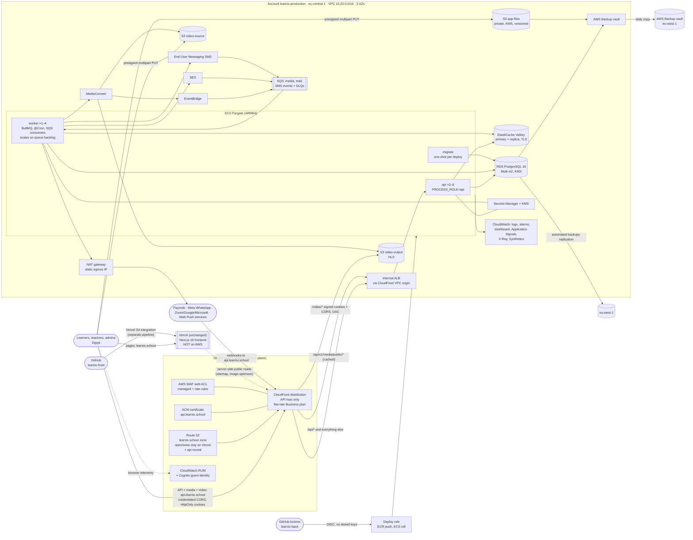
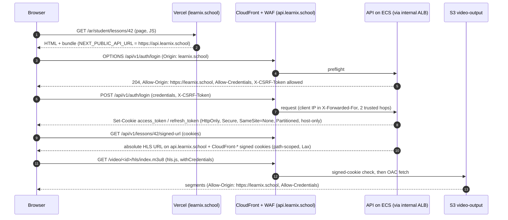

# Learnix on AWS: architecture

The definitive description of the target platform. Companion documents:
[AWS-SERVICE-DECISIONS.md](AWS-SERVICE-DECISIONS.md) (why each service),
[AWS-COST-ESTIMATE.md](AWS-COST-ESTIMATE.md), [AWS-DEPLOYMENT-RUNBOOK.md](AWS-DEPLOYMENT-RUNBOOK.md),
[AWS-PRODUCTION-READINESS.md](AWS-PRODUCTION-READINESS.md), [AWS-OPEN-ITEMS.md](AWS-OPEN-ITEMS.md).

**Division of responsibilities (decided 2026-10-13): the Next.js frontend stays on Vercel exactly as it is
today (same Vercel project, Git integration, domain `learnix.school`). AWS hosts everything else: the NestJS API,
BullMQ workers, PostgreSQL, Valkey, S3, video processing and delivery, messaging, monitoring, backups, secrets
and the API's edge (CloudFront + WAF). Nothing on AWS builds, hosts or routes frontend pages.**

**Status (2026-10-13): designed, coded and verified offline only. No AWS account exists yet, nothing has
been applied, and no statement here is backed by a live test.** Each item's verification status is in
AWS-PRODUCTION-READINESS.md.

## 1. Scope in one paragraph

Learnix (NestJS API + BullMQ workers, PostgreSQL, Redis) runs on AWS for hosting, data, caching, files, video,
email, SMS, push delivery, monitoring, secrets, DNS, the API's CDN and WAF, and infrastructure state. The
Next.js 16 frontend is **not** hosted on AWS: it stays on Vercel at `learnix.school` and calls the API at
`api.learnix.school` (section 3A). **It is not an AWS-only system**: the frontend host (Vercel), payments
(Paymob), WhatsApp messages (Meta), teachers' meeting accounts (Zoom / Google / Microsoft), source control and
CI orchestration (GitHub), browser push delivery (browser vendors' push services) and the domain registration
(Name.com) remain external, because the frontend is deliberately kept where it is, AWS offers no equivalent, or
the provider owns the channel (section 9). The launch is a **fresh start**: no data, files or videos are
migrated from Railway, R2 or Bunny. Bunny is fully retired from the code (2026-10-15).

## 2. Diagram

## 3. Services, purpose and selection

| Need                           | AWS service                                                                                                                 | Purpose in Learnix                                                                                                                                           | Selected because                                                                                                                                                                        | Rejected alternatives                                                                                                                                                                                                                                                          |
| ------------------------------ | --------------------------------------------------------------------------------------------------------------------------- | ------------------------------------------------------------------------------------------------------------------------------------------------------------ | --------------------------------------------------------------------------------------------------------------------------------------------------------------------------------------- | ------------------------------------------------------------------------------------------------------------------------------------------------------------------------------------------------------------------------------------------------------------------------------ |
| Web app hosting                | **Vercel (external, unchanged)**                                                                                            | Next.js 16 frontend: SSR, `proxy.ts` locale/role redirects, image optimisation, ISR sitemap, Vercel Analytics                                                | Already in production use; no migration, no rebuild; the frontend deploys through Vercel's own Git integration, separate from the AWS backend pipeline                                  | ECS Fargate `web` behind CloudFront (built and removed 2026-10-13: it added a service, an image pipeline and ~$33/month for no functional gain), S3 static export (breaks SSR/redirects), Amplify Hosting (Next 16 support unverified), OpenNext on Lambda (many moving parts) |
| API, workers, cron, migrations | **ECS Fargate** (`api`, `worker`, `migrate`)                                                                                | One image, role per service (`PROCESS_ROLE`); migrations as a one-shot task                                                                                  | Long-running BullMQ workers, in-process crons, 20 GB uploads handled by S3 not the API                                                                                                  | Lambda (15 min, no long-lived consumers), App Runner (no worker/one-shot shape), EKS (cost/complexity), EC2 (patching)                                                                                                                                                         |
| Relational data                | **RDS for PostgreSQL 16**, Multi-AZ in production                                                                           | All application data; 150 migrations; `uuid-ossp`, `pg_trgm`, `pgcrypto`                                                                                     | Drop-in for TypeORM/PG16, cheapest Multi-AZ at this size, PITR                                                                                                                          | Aurora (higher floor cost, unmeasured I/O; revisit Stage 3), self-managed PG                                                                                                                                                                                                   |
| Queues and cache               | **ElastiCache for Valkey** (node-based, TLS, AUTH, `noeviction`)                                                            | BullMQ queues, throttler, caches, alert cooldowns                                                                                                            | Redis-compatible, `noeviction` settable (BullMQ requirement), cheaper than Redis OSS                                                                                                    | ElastiCache Serverless (eviction policy control unverified), MemoryDB (durability not needed)                                                                                                                                                                                  |
| Files                          | **S3** `app-files` (SSE-KMS, versioned, private)                                                                            | Books, resources, homework, images, code exports, payment proofs                                                                                             | Presigned direct uploads; no proxying through the API                                                                                                                                   | Cloudflare R2 (directive), EFS (not object storage)                                                                                                                                                                                                                            |
| Video                          | **S3 + MediaConvert + CloudFront signed cookies + hls.js**                                                                  | Upload (multipart, ≤ 20 GB), HLS ladder 360/540/720p, thumbnails, signed playback                                                                            | Covers every Bunny feature Learnix used; delivery inside the CloudFront plan                                                                                                            | MediaPackage (only for DRM/JIT packaging), IVS (live only), Bunny (directive)                                                                                                                                                                                                  |
| CDN, TLS, DNS, edge security   | **CloudFront** (flat-rate Business plan), **ACM**, **Route 53**, **AWS WAF**                                                | One distribution for the API host `api.learnix.school`: dynamic API, cached public media, `/video/*` HLS with signed cookies and an exact-origin CORS policy | Private ALB through VPC origins, WAF included in the plan, video delivery ~8× cheaper than pay-as-you-go at Expected volume, same-site with the Vercel frontend so cookies keep working | Cloudflare (directive), pay-as-you-go CloudFront (cost), a single shared domain for web and API (impossible while Vercel serves the apex)                                                                                                                                      |
| Email                          | **SES** (DKIM, custom MAIL FROM, DMARC, config set → SNS → SQS)                                                             | Transactional email; bounce/complaint feedback                                                                                                               | Native, cheap, feedback events                                                                                                                                                          | MailerSend, Brevo (removed 2026-10-19)                                                                                                                                                                                                                                         |
| SMS                            | **AWS End User Messaging SMS** (Egypt sender ID, protect configuration, event destination)                                  | Guardian OTP and critical fallback; delivery receipts update `parent_messages`                                                                               | AWS-native, spend limit as a hard cap, delivery events                                                                                                                                  | Twilio (directive), SNS SMS (fewer controls)                                                                                                                                                                                                                                   |
| Push                           | **Web Push (VAPID) from the worker**                                                                                        | Browser notifications                                                                                                                                        | AWS has no Web Push service; this removes Firebase entirely                                                                                                                             | SNS / End User Messaging Push (native apps, still need FCM for web)                                                                                                                                                                                                            |
| Errors, traces, metrics, logs  | **CloudWatch Logs, metric filters, alarms, dashboard; Application Signals + X-Ray via ADOT**                                | JSON logs, error/feedback metrics, RED metrics and traces per service                                                                                        | AWS-native, no agent on hosts (sidecar), trace ↔ log correlation                                                                                                                        | Sentry (replaced after the parity window)                                                                                                                                                                                                                                      |
| Real-user analytics            | **CloudWatch RUM** (Cognito guest role limited to `PutRumEvents`)                                                           | Page views, Web Vitals, JS errors, failed fetches, collected from the browser of the Vercel-hosted app                                                       | Runs alongside Vercel Analytics (unchanged); can replace Sentry's browser capture after the parity window                                                                               | Vercel Analytics stays; no change to it                                                                                                                                                                                                                                        |
| Uptime                         | **CloudWatch Synthetics** heartbeat canary                                                                                  | API readiness and public catalogue on the API host, plus the Vercel home and login pages as seen from outside                                                | Outside-in check from AWS; one alarm covers both hosts                                                                                                                                  | External uptime services                                                                                                                                                                                                                                                       |
| Secrets and keys               | **Secrets Manager**, **KMS** CMKs                                                                                           | JWT/cookie/encryption keys, provider credentials, RDS master secret, Valkey auth                                                                             | Values never in Terraform state (write-only/ephemeral, RDS-managed password)                                                                                                            | SSM Parameter Store (no rotation integration for RDS)                                                                                                                                                                                                                          |
| Backups                        | **RDS automated backups + PITR**, cross-region replication; **AWS Backup** daily/monthly with deny-delete vault and DR copy | Database and files recovery                                                                                                                                  | Managed, policy-protected                                                                                                                                                               | Logical `pg_dump` to GitHub artifacts (removed: PII outside AWS)                                                                                                                                                                                                               |
| Queue/event plumbing           | **EventBridge**, **SNS**, **SQS** (+ DLQs)                                                                                  | MediaConvert job state, SES feedback, SMS delivery events                                                                                                    | Decoupled, retried, dead-lettered                                                                                                                                                       | Polling only (kept as the reconcile fallback for video)                                                                                                                                                                                                                        |
| Container registry             | **ECR** (immutable tags, scan on push)                                                                                      | One backend image (api, worker, migrate)                                                                                                                     | Native to ECS                                                                                                                                                                           | Docker Hub/GHCR                                                                                                                                                                                                                                                                |
| Governance                     | **Organizations, IAM Identity Center, SCPs, CloudTrail (org), GuardDuty, Access Analyzer, Budgets, Cost Anomaly Detection** | Account separation, audit, cost guardrails                                                                                                                   | Standard multi-account baseline                                                                                                                                                         | Single account                                                                                                                                                                                                                                                                 |
| Infrastructure as code         | **Terraform** (S3 native-lock state, KMS), GitHub Actions via OIDC                                                          | All of the above                                                                                                                                             | Existing team skill, plan/apply review, offline tests                                                                                                                                   | CloudFormation/CDK (team preference)                                                                                                                                                                                                                                           |

## 3A. Frontend-to-API request flow (Vercel to AWS)

- **Origins.** Frontend `https://learnix.school` (Vercel); API `https://api.learnix.school` (AWS). They share a
  registrable domain, so requests are _same-site, cross-origin_: `SameSite=Lax` cookies (video) are sent, the
  `SameSite=None` auth cookies do not depend on third-party-cookie policy, and the browser still enforces CORS.
- **No weakening to make it work.** The API keeps exact-origin credentialed CORS (`CORS_ORIGINS`, no wildcard,
  production validation rejects `*`, previews are refused by test), host-only cookies (`COOKIE_DOMAIN` stays
  unset and the isolation guard refuses a parent-domain value), `HttpOnly` credentials, the signed CSRF cookie
  plus `X-CSRF-Token` header, and role guards. Cookies are not shared with `staging.learnix.school`.
- **Edge.** WAF and rate rules see the real browser address (the browser calls CloudFront directly), so
  `TRUST_PROXY_HOPS=2` (CloudFront, ALB) is unchanged. Vercel's own servers call the API only for public reads
  (marketplace sitemap, certificate PDF links, image optimiser fetches of `/api/v1/media/public/*`).
- **Video.** `/video/*` answers with a CORS policy listing exactly the frontend origins and
  `Allow-Credentials: true`, because hls.js sends the signed cookies cross-origin.
- **Callbacks and webhooks** (Paymob, Meta, Zoom/Google/Microsoft OAuth) all use `https://api.learnix.school/api/v1/...`;
  the browser is redirected back to the Vercel site (`FRONTEND_URL`) afterwards.
- **Staging** follows the same shape: Vercel staging deployment at `https://staging.learnix.school`, API at
  `https://api.staging.learnix.school` behind a WAF IP allowlist. Vercel previews (`*.vercel.app`) are not trusted
  by either API unless the exact URL is listed in `cors_extra_origins`.

## 4. Resource dependencies (apply order)

1. `bootstrap/` per account: state bucket + KMS, GitHub OIDC provider, plan/apply roles (Phase 2).
2. `org/` in the management account: OUs, SCPs, Identity Center, org CloudTrail, GuardDuty delegation, budgets.
3. `environments/<env>`: KMS → network → logs/files buckets → secrets → RDS / Valkey → media (buckets,
   MediaConvert role, EventBridge, SQS) → messaging (SES, SMS) → ECS cluster/ECR → ALB → services →
   CloudFront/WAF/ACM/Route 53 → observability (alarms, dashboard, RUM, Synthetics) → backup → deploy role.
4. Out of Terraform (runbook): CloudFront flat-rate plan subscription, Application Signals discovery,
   SES production access, Egypt sender ID registration and protect configuration, secret values, Name.com
   NS change, provider dashboards (Paymob, Meta, OAuth), **Vercel environment variables and domain settings**
   (Terraform prints the values in `vercel_environment` but never writes to Vercel).

## 5. Networking

- VPCs: staging `10.10.0.0/16`, production `10.20.0.0/16`, DR reserved `10.30.0.0/16`; 2 AZs (third reserved).
- Production subnets: public (NAT only), private-app (internal ALB, tasks), private-data (RDS, Valkey; no
  internet route). Staging runs tasks in public subnets with public IPs instead of a NAT (cost), still only
  reachable through the internal ALB security group.
- The ALB is **internal**, reachable only from CloudFront VPC origins, and has exactly one target group (the
  API). Nothing in production has an inbound public IP. Client IP is preserved with `TRUST_PROXY_HOPS=2`.
- DNS: the Route 53 zone holds a copy of every current record, including the apex and `www` records that point
  at Vercel (their values come from Vercel's domain settings). Terraform adds one new name, `api.<domain>`. The
  apex is never pointed at AWS.
- Egress: one NAT gateway (static IP for provider allowlists); S3 gateway endpoint keeps S3 traffic off NAT.
- Security groups: ALB ← CloudFront VPC-origin SG; api ← ALB; worker/migrate no ingress; RDS ← app
  SGs; Valkey ← app SGs.

## 6. Security

- Accounts: management, log-archive/security, staging, production. SCPs: region allowlist (eu-central-1,
  us-east-1, eu-west-1), protect CloudTrail/GuardDuty, deny root, deny leaving the Org.
- People: Identity Center + MFA; no IAM users or access keys. Pipelines: GitHub OIDC roles pinned to one
  repository **and** one GitHub environment (`infra-<env>` for Terraform, `staging`/`production` for apps).
- Workloads: one task role per service, least privilege (S3 per bucket, MediaConvert + PassRole, SES on
  its identity, SMS, SQS consume, `cloudwatch:PutMetricData` pinned to `Learnix/Queues`, CloudWatch agent
  policy only when Application Signals is on). The application's RBAC remains the only control over user
  actions.
- Data: KMS on RDS, Valkey, app files, secrets, logs, SNS/SQS; TLS enforced to RDS (`rds.force_ssl`,
  CA bundle in the image) and Valkey (`rediss://`, `REQUIRE_TLS_BACKENDS`); S3 TLS-only, Block Public Access.
- Edge: WAF managed rules (Common, KnownBadInputs, IP reputation), per-IP and auth-path rate rules (COUNT
  until tuned, then BLOCK); staging behind an IP allowlist; HSTS and security headers; exact-origin credentialed
  CORS (API and `/video/*`). Vercel's servers share egress addresses, so their public reads count against the
  generous general rate rule (watch it during tuning).
- Containers: non-root `node` user, `initProcessEnabled`, immutable image tags, image scan in the pipeline,
  read-only root filesystem (staging first) with `/tmp` as the only writable volume.
- Video: playback only with short-lived, path-scoped CloudFront signed cookies; the output bucket is
  private behind OAC; uploads are presigned and re-verified (size, type) server-side.
- Payments: Learnix never sees card data (Paymob-hosted page); webhooks are HMAC-verified.

## 7. Monitoring

| Signal                 | Mechanism                                                                                                                                                                                                                                                                           |
| ---------------------- | ----------------------------------------------------------------------------------------------------------------------------------------------------------------------------------------------------------------------------------------------------------------------------------- |
| Errors                 | JSON logs → metric filter `ApplicationErrors` → threshold alarm + anomaly-detection alarm; saved Logs Insights queries (`errors-by-context`, `recent-errors`, `http-5xx`, `slow-routes-p95`, `provider-feedback`, `payments-and-webhooks`, `scheduled-jobs`, `requests-by-release`) |
| Traces and RED metrics | ADOT Node.js auto-instrumentation (init container) + CloudWatch agent sidecar → X-Ray + Application Signals (api, worker)                                                                                                                                                           |
| Browser                | CloudWatch RUM in the Vercel-hosted app (page views, Web Vitals, JS errors, HTTP) + alarm on `JsErrorCount`; Vercel Analytics unchanged                                                                                                                                             |
| Availability           | Synthetics heartbeat canary (production, started once the API host is live): API readiness and catalogue on the API host, home and login on the Vercel site + alarm; ALB unhealthy-target alarms. Vercel's own availability is outside AWS monitoring beyond this outside-in check  |
| Capacity               | ECS CPU/memory, RDS CPU/connections/storage, Valkey memory/CPU alarms; dashboard `learnix-<env>-overview`                                                                                                                                                                           |
| Queues                 | Worker publishes `QueueBacklog` / `DeadLetterJobs`; backlog alarm (missing data = breaching); SQS DLQ alarms                                                                                                                                                                        |
| Messaging              | `SmsDeliveryFailures` and `MailBouncesAndComplaints` metric filters + alarms; SMS receipts update `parent_messages`                                                                                                                                                                 |
| Cost                   | Budgets and Cost Anomaly Detection (org), CloudFront plan allowance alerts                                                                                                                                                                                                          |

All alarms publish to the `learnix-<env>-alerts` SNS topic (email subscriptions from `alert_emails`).

## 8. Backups and recovery

| Layer         | Mechanism                                                                                                                         | RPO / retention                   |
| ------------- | --------------------------------------------------------------------------------------------------------------------------------- | --------------------------------- |
| RDS           | Automated backups + PITR (14 days production), replicated to eu-west-1 with its own KMS key                                       | ≤ 5 min (PITR); region loss ≤ 1 h |
| RDS + files   | AWS Backup: daily (35 days) and monthly (365 days), vault policy denies deletion except by root, daily copy to an eu-west-1 vault | 24 h                              |
| Files         | S3 versioning (non-current versions 30 days)                                                                                      | object-level                      |
| Video outputs | Re-transcode from the source bucket (sources move to Glacier after 30 days)                                                       | hours                             |
| Valkey        | Rebuildable; repeatable jobs re-register at boot                                                                                  | in-flight delayed jobs            |
| Deploys       | Pre-deploy manual RDS snapshot (production pipeline); previous task-definition revisions                                          | per deploy                        |

Drill: `scripts/pitr-restore-drill.sh` + `scripts/restore-verification.sql` (monthly).

## 9. External dependencies that remain (and why)

| Dependency                                                               | Why it is not replaced by AWS                                                                                                                                                                                                                                                      |
| ------------------------------------------------------------------------ | ---------------------------------------------------------------------------------------------------------------------------------------------------------------------------------------------------------------------------------------------------------------------------------- |
| **Paymob** (payments)                                                    | Licensed payment processor and acquirer connection in Egypt. AWS offers no payment gateway; building card processing would put Learnix in full PCI DSS scope. AWS hosts everything around it: initiation API, HMAC webhooks, reconciliation crons, ledger, refunds, proof storage. |
| **Meta WhatsApp Cloud API**                                              | Meta owns the WhatsApp channel; any AWS route (End User Messaging Social) still delivers through Meta. Kept direct.                                                                                                                                                                |
| **Zoom / Google Meet / Microsoft Teams**                                 | Teachers connect their own meeting accounts by OAuth; the meetings exist in those platforms.                                                                                                                                                                                       |
| **Vercel** (frontend host)                                               | Deliberately kept: the Next.js frontend is already deployed there and is not migrated. Vercel owns frontend hosting, its build pipeline and Vercel Analytics; it needs no AWS credentials.                                                                                         |
| **GitHub**                                                               | Source control and CI orchestration; it reaches AWS through OIDC with no stored keys (backend repository only).                                                                                                                                                                    |
| **Browser push services** (FCM endpoint for Chrome, Mozilla, Apple, WNS) | Part of the Web Push standard: every browser delivers through its vendor's service. No account or SDK is involved.                                                                                                                                                                 |
| **Name.com** (registrar)                                                 | Registration can stay; DNS is served by Route 53. Transfer to Route 53 Domains is optional.                                                                                                                                                                                        |

## 10. Staging and production separation

|                 | Staging                                                                                                 | Production                                                                                                                                               |
| --------------- | ------------------------------------------------------------------------------------------------------- | -------------------------------------------------------------------------------------------------------------------------------------------------------- |
| Account / state | `learnix-staging`, own state bucket and roles                                                           | `learnix-production`, own state bucket and roles                                                                                                         |
| Network         | 10.10.0.0/16, tasks in public subnets, no NAT                                                           | 10.20.0.0/16, private subnets, NAT                                                                                                                       |
| Capacity        | single-AZ micro DB, one Valkey node, `PROCESS_ROLE=all` (optional split)                                | Multi-AZ DB, Valkey replica, split api/worker, autoscaling                                                                                               |
| Frontend        | Vercel staging deployment (a stable domain such as `staging.learnix.school`)                            | Vercel production, unchanged                                                                                                                             |
| API host        | `api.staging.learnix.school` (or the `cloudfront.net` name until the domain stage)                      | `api.learnix.school`                                                                                                                                     |
| Access          | WAF IP allowlist on the API (plus open paths for webhooks and the two public reads Vercel makes itself) | public, WAF managed + rate rules                                                                                                                         |
| Data            | synthetic only (`seed:staging`), names contain `staging` (isolation guard)                              | real; guard rejects `staging` names and `MAIL_ALLOWLIST`                                                                                                 |
| Providers       | Paymob TEST, `SMS_MODE=sandbox`, SES sandbox + `MAIL_ALLOWLIST`                                         | Paymob LIVE, SMS live (after sender ID), SES production access                                                                                           |
| Safety          | `force_destroy`, short key windows, read-only root FS on                                                | deletion protection, `prevent_destroy`, 30-day key windows, backup vault, DR copies                                                                      |
| Deploys         | backend: push to `develop`; frontend: Vercel (separate)                                                 | backend: manual dispatch, reviewers, staging-first gate, DB-owner approval for destructive migrations; frontend: Vercel production deployment (separate) |
